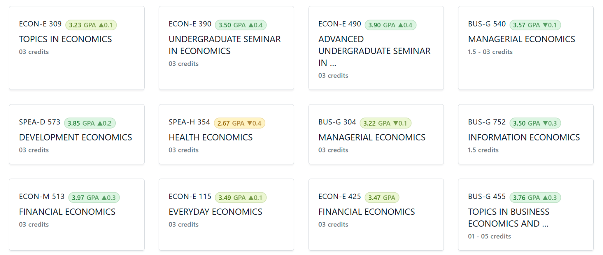
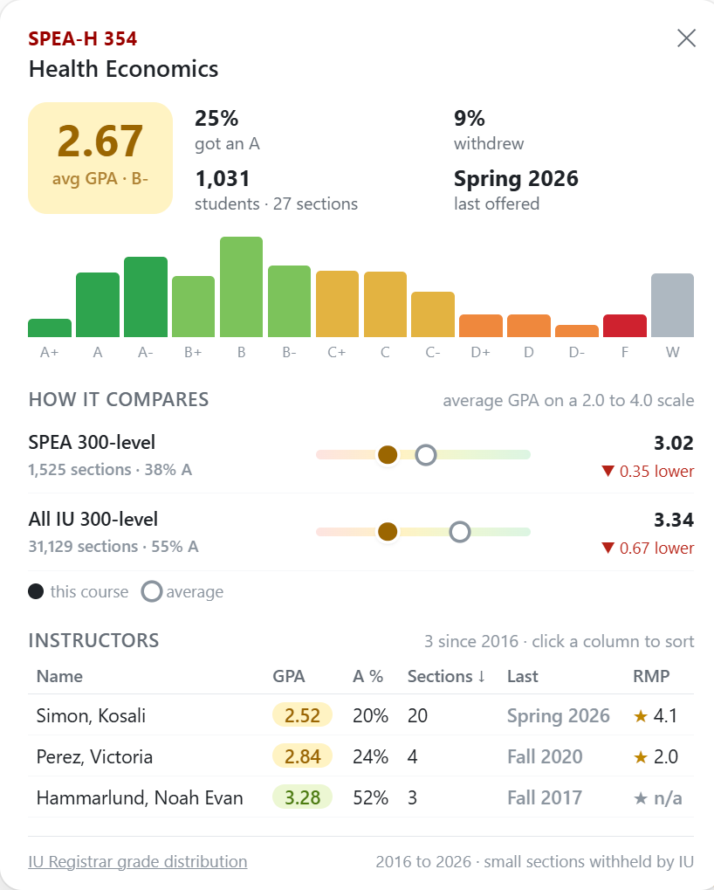

<div align="center">

# IU Stellic Plus

**See real grade distributions and professor ratings for every course, right inside Stellic.**

[](https://github.com/Msde-7/iu-stellic-plus/archive/refs/heads/main.zip)


[](LICENSE)



</div>

## Install in two minutes

### 1. Download

Click **[Download ZIP](https://github.com/Msde-7/iu-stellic-plus/archive/refs/heads/main.zip)** and unzip it anywhere you
will keep it, such as your Documents folder. Chrome and Edge load the extension from that folder, so don't delete it
afterwards.

### 2. Add it to your browser

| Chrome                                                     | Edge                                                       |
| ---------------------------------------------------------- | ---------------------------------------------------------- |
| Go to `chrome://extensions`                                | Go to `edge://extensions`                                  |
| Turn on **Developer mode** in the top right                | Turn on **Developer mode** in the left sidebar             |
| Click **Load unpacked**                                    | Click **Load unpacked**                                    |
| Open the unzipped folder and select its `extension` folder | Open the unzipped folder and select its `extension` folder |

### 3. Open Stellic

Go to [stellic.iu.edu](https://stellic.iu.edu). Badges appear next to every course. Pin the extension from the puzzle
piece icon in the toolbar to reach search and settings in one click.

### Updating

Download the ZIP again, replace the old folder with the new one, then click the reload arrow on the extension's card
in `chrome://extensions` or `edge://extensions`.

## What you can do with it



**Spot the easy A and the weed-out course.** Every course code gets a badge with its average GPA since 2016, colored
from green to red. The arrow shows whether it grades higher or lower than its department at the same level.

**Look before you enroll.** Hover a badge for the full picture. You get the grade histogram, how many students got an
A, how many withdrew, and when it was last offered.

**Compare it to everything else.** Each card shows how the course stacks up against its department and against all
of IU at that level, so a 3.0 in a tough department reads differently from a 3.0 in an easy one.

**Pick the professor, not just the class.** The card lists every instructor who taught the course with their own GPA,
share of A grades and RateMyProfessors rating. Click a column to sort.

**Choose the right section.** In a course panel and in the section picker, each instructor gets a chip with their GPA
and rating for that course.

**Weigh your requirement options.** Expand a requirement in Track Progress and every course that satisfies it shows
its badge, so you can compare them side by side.

**Make it yours.** The toolbar popup searches any course and lets you choose what the badge shows, switch between
hover and click, hide chips or ratings, and pick a color theme.

<br clear="right">

## Privacy

Everything runs in your browser. Grade data ships inside the extension, and the only network request it makes is
to RateMyProfessors to look up instructor ratings, which are cached for a week. It doesn't collect, store or send
anything about you or your Stellic account.

## Where the data comes from

Grades come from the public
[IU Registrar grade distribution reports](https://gradedistribution.registrar.indiana.edu/) for Bloomington, from
2016 through 2026. IU withholds sections with very few students, and those show as **no grades**. Ratings come from
[RateMyProfessors](https://www.ratemyprofessors.com/).

This project is not affiliated with Indiana University, Stellic or RateMyProfessors.

<details>
<summary><b>For developers</b></summary>

### Layout

```
extension/
  manifest.json      Manifest V3
  background.js      service worker for grade lookups and the RateMyProfessors cache
  content/           content script, where loader.js imports main.js as an ES module
  lib/               pure logic shared by every context and covered by unit tests
  ui/                card, badge, DOM helper and the shared stylesheet
  popup/             toolbar popup
  data/grades.json   generated by tools/build_data.py
tools/build_data.py  turns the registrar's per-term CSVs into grades.json
tests/               node:test, pytest and end-to-end suites
```

### Checks

Needs Node 22 or later and Python 3.11 or later with ruff, mypy and pytest.

```bash
npm install
npm run check
```

That runs ESLint, Prettier, a strict TypeScript check of the JSDoc types, the JS unit tests, and ruff, strict mypy
and pytest for the build script.

The end-to-end test loads the extension into a real browser against a mock Stellic page. Pass it the path to Edge,
or to [Chrome for Testing](https://developer.chrome.com/blog/chrome-for-testing) since branded Chrome ignores
`--load-extension`.

```bash
npm run test:e2e -- "C:/Program Files (x86)/Microsoft/Edge/Application/msedge.exe"
```

### Updating the data

Download each term from the registrar site as `IUB_GradeDistribution_<year>_<term>.csv`, then rebuild.

```bash
npm run build:data -- <csv-folder> extension/data/grades.json --since 2016
```

</details>

## License

[MIT](LICENSE)
